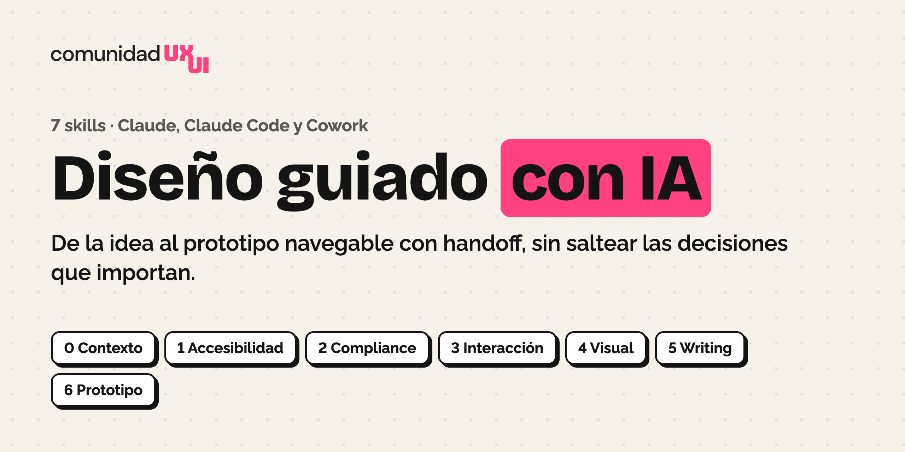

<p align="center"></p>

# Diseño guiado con IA

**7 skills que llevan una idea de producto hasta un prototipo navegable con handoff,** sin saltear las decisiones que importan: quién lo usa, accesibilidad, requisitos legales, interacción, sistema visual y textos.

[](LICENSE)
[](skills/)
[](#en-claude-code)
[](#)

---

## Qué resuelve

Pídele a una IA «diséñame una app» y te entrega pantallas lindas que nadie pensó: sin usuario definido, con contraste que no pasa, sin estados de error y con textos de relleno. Este stack hace lo contrario. Es un sistema en capas: cada skill produce un documento que la siguiente usa, y al final tienes un prototipo con todas las decisiones integradas.

Se adapta a tu nivel: si sabes lo que quieres, va rápido; si estás aprendiendo, te guía sin dar nada por sabido.

## Las 7 skills

| # | Skill | Qué hace | Qué te entrega |
|---|-------|----------|--------|
| 0 | [**Contexto Base**](skills/skill-0-contexto-base/SKILL.md) | Define quién usa el producto, qué es, qué quiere el negocio y cuáles son las prioridades | Documento de Contexto Base |
| 1 | [**Accesibilidad**](skills/skill-1-accesibilidad/SKILL.md) | Define los parámetros WCAG por área: contraste, tipografía, carga cognitiva, movimiento, motricidad, audio y tecnología asistiva | Restricciones concretas para las demás skills |
| 2 | [**Compliance**](skills/skill-2-compliance/SKILL.md) | Define los requisitos legales que impactan el diseño (GDPR, LGPD, CCPA, COPPA, HIPAA, PSD2, FERPA). Se activa solo si aplica | Los flujos legales obligatorios |
| 3 | [**Interacción y Layout**](skills/skill-3-interaccion/SKILL.md) | Navegación, layout, responsive, formularios, estados del sistema, animaciones y consistencia de componentes | Wireframe navegable en escala de grises |
| 4 | [**Visual**](skills/skill-4-visual/SKILL.md) | Color, tipografía, espaciado, elevación e iconografía. Calcula el contraste con la fórmula WCAG, no a ojo | Style guide y tokens completos |
| 5 | [**UX Writing**](skills/skill-5-writing/SKILL.md) | Voz, tono, reglas de escritura y microcopy para cada tipo de componente | Guía de voz y microcopy listo |
| 6 | [**Composición**](skills/skill-6-composicion/SKILL.md) | Une todo en un prototipo de media fidelidad | Prototipo navegable y documento de handoff |

**En stack (lo recomendado):** de la 0 a la 6, en orden. Cada una lee lo que definió la anterior y no repite preguntas.
**De a una:** cada skill funciona sola. Solo el microcopy, la 5. Revisar el visual de algo que ya existe, la 4 en modo validación.
**La 2 es condicional:** se activa en sectores regulados (salud, finanzas, educación). **La 6 necesita al menos la 3 y la 4.**

## Lo que tienes al final

- un brief de producto con usuario, negocio y prioridades;
- restricciones de accesibilidad concretas por área;
- los flujos legales que hay que diseñar, si aplica;
- un wireframe navegable que valida la estructura antes del visual;
- un sistema visual con los tokens listos para desarrollo (en variables CSS: cambias el color primario en un lugar y se actualiza todo);
- microcopy real para cada componente, con humor solo donde corresponde;
- un prototipo navegable y un documento de handoff.

Todo antes de abrir Figma.

## Cómo empezar

Abre un chat nuevo y escribe tu idea: *«Quiero diseñar una app de finanzas personales para personas de 18 a 30 años.»* La skill 0 confirma si quieres empezar por el contexto y te pregunta por bloques. Si respondes «no sé», aplica la opción más conservadora y la deja anotada como supuesto para revisar.

## Instalación

### En claude.ai y en Cowork

1. Descarga los zips `skill-0-contexto-base.zip` a `skill-6-composicion.zip` (puedes subir varios a la vez) desde **[Releases](https://github.com/ComunidadUXUI/diseno-guiado-con-ia/releases/latest)**.
2. En Claude, entra a **Personalizar → Skills → + → Subir una skill** y súbelo tal como lo descargaste.
3. Abre un chat nuevo y pide lo que necesitas.

Guía paso a paso con capturas: **[cómo subir una skill a claude.ai](NOTION_LINK)**.

### En Claude Code

```
/plugin marketplace add ComunidadUXUI/diseno-guiado-con-ia
/plugin install diseno-guiado@diseno-guiado-con-ia
```

Después pide lo que necesitas o llama la skill directo: `/skill-0-contexto-base`.

### En Codex, Cursor, Gemini CLI y otros agentes

```bash
npx skills add ComunidadUXUI/diseno-guiado-con-ia
```

Necesita Node.js 22.20 o superior. Si tu agente no instala skills, deja el repositorio en tu carpeta de trabajo y pídele que lea el `SKILL.md` de la carpeta `skills/` y lo siga.

## Qué hay adentro

```
skills/
├── skill-0-contexto-base/     el brief del producto
├── skill-1-accesibilidad/     restricciones WCAG por área
├── skill-2-compliance/        requisitos legales que impactan el diseño
├── skill-3-interaccion/       estructura y wireframe navegable
├── skill-4-visual/            sistema visual y tokens
├── skill-5-writing/           voz, tono y microcopy
└── skill-6-composicion/       prototipo y handoff
```

¿Ya tienes un producto y quieres evaluarlo en lugar de crearlo? Para eso está [Auditoría UX con IA](https://github.com/ComunidadUXUI/auditoria-ux-con-ia).

## Límites honestos

- **El prototipo es de media fidelidad.** Sirve para validar estructura y decisiones; el pulido visual final sigue siendo tu trabajo.
- **Compliance orienta, no asesora.** La skill 2 señala qué requisitos legales impactan el diseño; la validación final es de un profesional legal.
---

## Diseña con feedback de verdad

Las skills te ordenan las decisiones. Que alguien con más experiencia mire tu prototipo y te diga qué defender y qué cambiar es lo que hacemos en **[Comunidad UX/UI](https://www.skool.com/comunidaduxui/about)** con feedback sobre tus propios trabajos.

¿Prefieres empezar por correo? Suscríbete a **[Minuto UX](https://comunidad-uxui.kit.com/fb40f8e711)**, el newsletter de Comunidad UX/UI.

**Más skills de Comunidad UX/UI:** [Auditoría UX con IA](https://github.com/ComunidadUXUI/auditoria-ux-con-ia) · [Excalidraw UX](https://github.com/ComunidadUXUI/excalidraw-ux) · [Crea tu asesor](https://github.com/ComunidadUXUI/crea-tu-asesor) · [Modo Fable](https://github.com/ComunidadUXUI/modo-fable) · [Ahorro de tokens](https://github.com/ComunidadUXUI/ahorro-de-tokens)

## Licencia

[CC BY-NC-SA 4.0](LICENSE). Puedes usarla, adaptarla y compartirla citando a Comunidad UX/UI, sin uso comercial y con la misma licencia.
